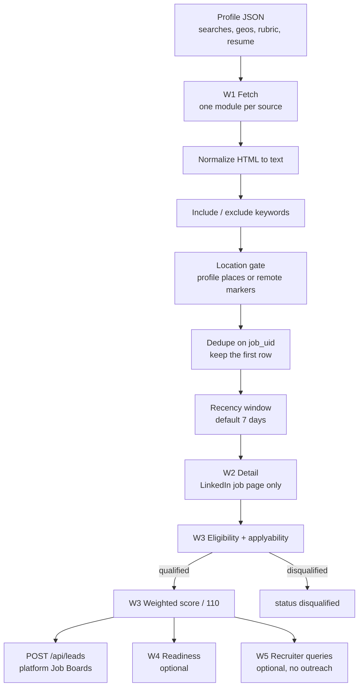

# Job discovery pipeline

Ported from the n8n workflows W1 (fetch), W2 (detail), and W3 (qualify and score). W4 and W5 are optional stages. Storage is `POST /api/leads` on this dashboard, not the original Google Sheet or the old JobPool app.

A row needs `job_uid`, a title, and a description before qualification. LinkedIn search cards have no description, so W2 fetches the job page and keeps the new text only when the page looks like a posting. Other sources already return the description. An expired Working Nomads document is dropped at fetch. A posting with no parseable date is dropped when the profile requires one. The same `job_uid` seen twice in one run is stored once. Pushing again uses that uid as `business_key`, and the API merges the lead.

## Score

The W3 rubric is implemented directly so a run does not need a model. Weights are title 25, seniority 10, skills 15, experience 10, qualifications 10, industry 10, location 15, remote arrangement 10, compensation 5. The total is half-up rounded after dividing by 110. Tiers are A 85–100, B 70–84, C 45–69, D below 45. Priority is High from 75, Medium from 70, otherwise Low. Dashboard `classification` is `priority` at 75+, `potential` from 45, and `deprioritize` below that or when the job is disqualified.

Set `LLM_API_KEY` and pass `--llm` to send the same qualification prompt to an OpenAI-compatible endpoint instead. The deterministic rubric remains the default.

## Sources

| Source id | Origin | How it is fetched | Notes |
|---|---|---|---|
| `linkedin` | W1 | Public search HTML, `f_TPR` age window | Detail page scraped in W2. Cards without a description stay pending. |
| `naukrigulf` | W1 | `GET /spapi/jobapi/search` | Public desktop client headers from the workflow. |
| `efinancialcareers` | W1 | `GET /v1/efc/jobs/search` | Keyword, location, country, currency from the profile. |
| `freehire` | W1 | `GET /api/v1/jobs/search` | Countries and work mode from the profile. |
| `greenhouse` | W1 | `GET /v1/boards/{token}/jobs?content=true` | Board token and company name are profile fields. |
| `jooble` | W1 | `POST /api/{JOOBLE_API_KEY}` | Key is an env var. The original URL key is not in the repo. |
| `workingnomads` | W1 | `POST /jobsapi/_search` | `expired: true` documents are dropped. |
| `weworkremotely` | W1 | `GET /remote-jobs.rss` | Company is taken from a `Company: Title` heading when present. |
| `ashby` | W1 | `GET /posting-api/job-board/{slug}` | Company slugs come from the profile. |
| `indeed` | W1 | Apify actor `BIeK7ZcYUrdxDgOEQ` | Needs `APIFY_TOKEN`. |
| `upwork` | W1 | Apify actor `QRHJxnLxIAxpfHCcu` | Queries and category come from the profile. |
| `gcc` | W1 | Apify actor `T1LDITQDDdL824BJg` | Bayt, GulfTalent, Foundit, Tanqeeb. |
| `michaelpage` | W1 | Firecrawl scrape of the listing URL, then the markdown parser | Needs `FIRECRAWL_API_KEY`. Undated cards fail the recency rule. |

Pagination in the original graph is the first page only. This port does the same.

## Not ported from the experimental workflow

| Item | Why |
|---|---|
| Apify actor `ymUwdLC4F3GGmZkg4` | Older GCC actor. The final graph uses `T1LDITQDDdL824BJg`, which is the `gcc` source. |
| Firecrawl of one Bayt job URL | A single posting, not a search. |
| Firecrawl of an Upwork search page | Replaced in the final graph by the Upwork actor above. |
| Upwork actor `FlbDgNCfA8bOdFQWT` | Present only on the experimental canvas, not connected in final W1. |
| "Test AI provider" chat node | Not a job source. |

## Optional stages

W4 readiness (`--stage readiness`) selects profile bullets that share words with the posting and writes resume guidance plus a first-person cover letter. It does not add employers, metrics, or skills that are absent from the profile. With `--llm` and `LLM_API_KEY` it sends the original no-invention prompt instead.

W5 recruiters (`--stage recruiters`) keeps the geography test, the tiered query builder, the score threshold, dedupe by profile URL then name+company, and the follow-up offsets. Results stay `REVIEW_REQUIRED`. The stage does not call a search engine and does not send email or LinkedIn messages. Wiring a search provider such as Brave is a follow-up.

High-priority alerts print in the dry-run payload. `--notify` posts them to Telegram only when `TELEGRAM_BOT_TOKEN` and `TELEGRAM_CHAT_ID` are set.
